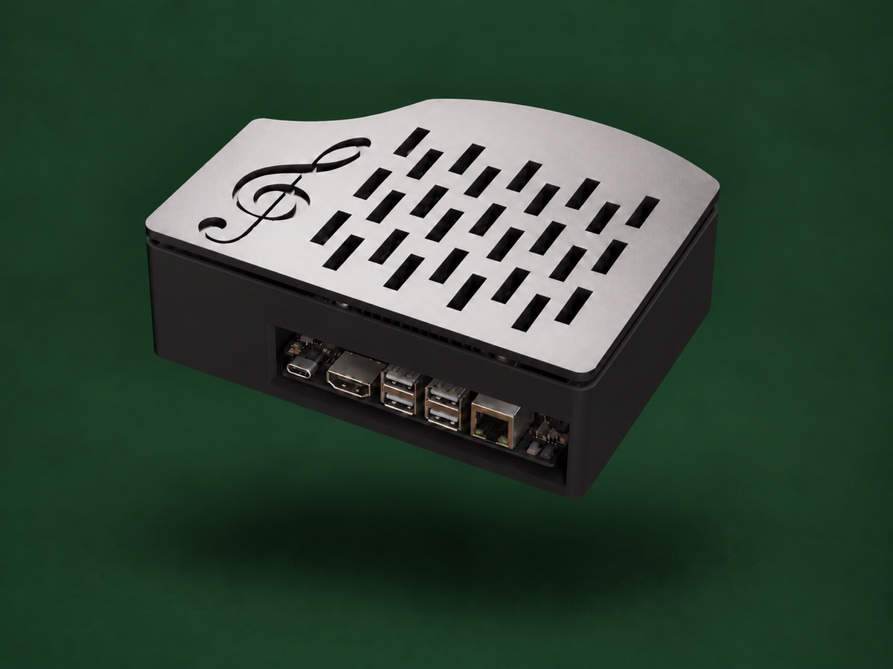
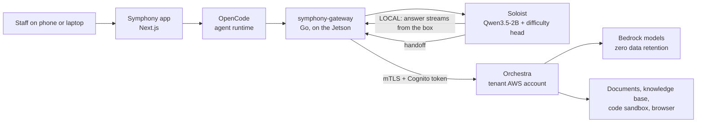
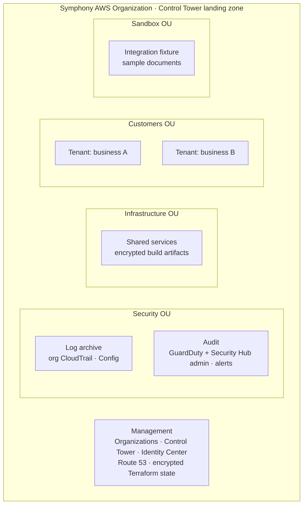

# Symphony

**Private AI for small businesses, on a box in the back office.**

Symphony puts a small NVIDIA Jetson in the business. On it runs **Soloist**, a
local model router built on Qwen3.5-2B. For every prompt, Soloist decides in a
single forward pass whether the box can answer it or whether it needs more help.
If the box can, the same pass keeps going and answers locally: nothing leaves
the building and it costs nothing. If it can't, the prompt goes to
**Orchestra**, an agent that runs in the business's own dedicated AWS account,
on Bedrock models with zero data retention.

Built for Palmetto Hacks, Fall 2026.



- [The gap we fill](#the-gap-we-fill)
- [How it works](#how-it-works)
- [Soloist: the on-prem router](#soloist-the-on-prem-router)
- [The gateway and the app](#the-gateway-and-the-app)
- [Orchestra and the AWS platform](#orchestra-and-the-aws-platform)
- [Multi-tenancy](#multi-tenancy)
- [Security controls](#security-controls)
- [Cost footprint](#cost-footprint)
- [Repository layout](#repository-layout)
- [Getting started](#getting-started)
- [Status and known gaps](#status-and-known-gaps)

## The gap we fill

Small and mid-sized businesses want what AI can do, but the usual options force
a trade-off:

| Option | What goes wrong for a small business |
| --- | --- |
| Public chat apps and APIs | Customer lists, payroll, contracts and recipes leave the building and land on someone else's servers, under someone else's retention terms. |
| A GPU server on-prem | Thousands of dollars up front, someone to run it, and it still can't match a frontier model on hard work. |
| An enterprise private-cloud build | Weeks of consulting, an AWS bill nobody understands, and no on-site piece at all. |

Symphony takes a hybrid approach: answer locally whenever the local model is
good enough, escalate only when it isn't, and keep every cloud call inside an
AWS account that belongs to the business. That means:

- **Privacy by default.** Simple and sensitive work stays on the box. Data the
  owner marks as `local-only` never leaves, and both the device and the cloud
  enforce that.
- **Cost by default.** A local answer costs $0. You only pay for a cloud model
  when the prompt actually needs one.
- **No AI expertise needed.** The owner signs in, picks what to keep private,
  sets a monthly limit, and invites the team. Symphony handles the rest.

## How it works



1. Someone starts a **job** in the Symphony app (each job is an OpenCode session).
2. Every model call goes to **symphony-gateway**, the Jetson's single endpoint.
3. The gateway sends the prompt to **Soloist**. In one prefill, Soloist scores
   how hard the prompt is and checks it for secrets.
4. **Easy and allowed:** Soloist answers with the same model, reusing the prefill
   it just computed, and streams the tokens back.
5. **Hard:** the gateway hands the conversation to **Orchestra** over mutual TLS,
   as the signed-in person. Orchestra answers with an allowlisted Bedrock model
   and its tools, and streams back.
6. The gateway records who asked, where it ran, which model answered, the tokens
   used and the cost. It never records the text.

## Soloist: the on-prem router

Soloist ([`router/`](router/)) is the main product. It is one model doing two
jobs on a Jetson Orin Nano: a **router** that decides where each prompt goes,
and a **local LLM** that answers the prompts it keeps.

### One backbone, two heads

```text
messages → secret scanner → Qwen chat template (thinking off)
                                   │
                   ONE prefill through Qwen3.5-2B (INT4 AWQ)
                                   │
           ┌───────────────────────┴───────────────────────┐
     layer 10 residual,                         final hidden state
     last prompt token                          + KV cache (~1 GB)
           │                                               │
   decision head (regression)                              │
   → difficulty score d                                    │
           │                                               │
   d ≤ cutoff and no flags? ── yes → LOCAL ──→ LM head → first token → decode
           │
           no → PRIVATE_AWS handoff (cache discarded, LM head never runs)
```

- **Backbone.** `Qwen/Qwen3.5-2B`, quantized once to INT4 AWQ and never changed
  afterwards. It runs with thinking off and only the language model is loaded
  (no vision encoder).
- **Decision head.** A small regression MLP that reads the layer-10 residual
  stream at the last prompt token: standardize → Linear(2048, 256) → ReLU →
  Dropout(0.1) → Linear(256, 1). Its output is a standardized **2PL IRT
  difficulty** score, learned from which models succeed or fail on each
  [LLMRouterBench](https://huggingface.co/datasets/NPULH/LLMRouterBench) item.
  Zero is average difficulty; higher means harder. One cutoff turns the score
  into a route.
- **LM head.** For a LOCAL route, Soloist runs the backbone's own LM head on the
  final state to produce the answer. There is no second model and no second
  prompt; the router *is* the local LLM.
- **About 1 GB of KV cache.** The full prefill has already finished when the
  decision is made, so the cache (attention K/V plus Qwen's GatedDeltaNet
  convolution and recurrent state) is ready. The first output token comes
  straight from the prefill state, and every later token is a single-token step
  over that cache. Deciding adds almost no time between the prompt and the
  first token of the answer. Soloist keeps about 1 GB of KV cache in memory for
  this, which fits next to the INT4 weights in the Orin Nano's memory.
- **Fail-closed safety.** A regex scanner flags private keys, AWS keys, bearer
  tokens, labelled secrets, credential URLs, SSNs and API tokens. Flagged or
  unclassified content is treated as sensitive, and a difficulty score is never
  taken as evidence that data is public. The only cloud route the policy accepts
  is the business's own AWS account (`PRIVATE_AWS`); the config refuses any
  other target.

**How well it routes** (held-out test set,
[`router/difficulty-head/out/eval_report.md`](router/difficulty-head/out/eval_report.md)):

| Metric | Result |
| --- | --- |
| Spearman correlation with true IRT difficulty | 0.75 (MLP), 0.75 (ridge baseline) |
| AUC for predicting a model's correctness from −d | Qwen3-8B 0.74, GLM-4.6 0.83, GPT-5 0.80 |
| Feature layer | 10 of 24; the routing signal is ready 46% of the way through the layers |

Training and evaluation live in
[`router/difficulty-head/`](router/difficulty-head/README.md). The router API
(FastAPI) serves `GET /health`, `GET /v1/model/info`, `POST /v1/decision`
(decide only; never runs the LM head) and `POST /v1/chat` (decide, then answer
or hand off). For details, see
[`router/docs/qwen35_difficulty.md`](router/docs/qwen35_difficulty.md).

## The gateway and the app

**symphony-gateway** ([`gateway/`](gateway/)) is a single static arm64 Go
binary (standard library only) and the only endpoint the agent runtime talks
to. It:

- serves an OpenAI-compatible API (`/v1/chat/completions`, `/v1/models`)
  protected by a per-box key, plus internal routes protected by a shared secret;
- sends every prompt to Soloist first, and keeps a conversation on Orchestra
  once Soloist has handed it off, so the tool calls that follow stay consistent;
- calls Orchestra with the box's device certificate (mTLS, TLS 1.2+) and a
  fresh Cognito access token for the person who started the job;
- writes a usage ledger (who, where, model, tokens, cost) that never contains
  prompt or answer text.

**The Symphony app** ([`app/`](app/)) is a Next.js app with Today, Work, Team,
Privacy and spending, and a Coding agent tab. People sign in through the
business's Cognito user pool (or company SSO). The owner chooses what stays
private, sets the monthly limit, and invites staff by email. Every job shows
where it ran and what it would have cost on a cloud model. See
[`app/README.md`](app/README.md).

## Orchestra and the AWS platform

All AWS infrastructure is Terraform in [`cloud/terraform/`](cloud/terraform/):
eight roots applied in order, each with its own state file and an account
guard. Every root is tested offline with mocked providers. An architecture
diagram is in
[`docs/architecture/aws-infrastructure.md`](docs/architecture/aws-infrastructure.md).



| # | Terraform root | Account | What it creates |
| --- | --- | --- | --- |
| 1 | `bootstrap/` | Management | AWS Organization, Security OU, log archive and audit accounts, KMS-encrypted S3 Terraform state bucket |
| 2 | `landing-zone/` | Management | AWS Control Tower landing zone (org CloudTrail, AWS Config, log buckets) with its own KMS key |
| 3 | `organization/` | Management + audit | Infrastructure, Customers and Sandbox OUs; account vending (Control Tower Account Factory); SCPs; GuardDuty and Security Hub with the audit account as delegated admin; finding alerts; IAM Identity Center users, groups and permission sets; per-tenant budgets |
| 4 | `shared-services/` | Shared services | KMS key and an encrypted artifacts bucket |
| 5 | `tenant-baseline/` | Each tenant | Tenant KMS key, Cognito user pool, device registry (DynamoDB), encrypted log group, account hygiene |
| 6 | `sandbox-fixture/` | Fixture | Encrypted documents bucket with approved sample documents |
| 7 | `tenant-workload/` | Each tenant | Orchestra and everything around it (below) |
| 8 | `external-aws-connector/` | Document-owning account | A read-only cross-account role (with an external ID) that Orchestra's document tool can assume |

**Orchestra, per tenant** (`tenant-workload/`):

| Piece | AWS services |
| --- | --- |
| Edge ingress | API Gateway REST API on a custom domain (`api.<tenant>.symphony-edge.link`) with mutual TLS against an S3 truststore, ACM certificate, Route 53 records, WAF web ACL, and the default `execute-api` endpoint turned off |
| Authorization | A Lambda REQUEST authorizer that checks the device certificate against the device registry and verifies the user's Cognito token |
| Model endpoint | Streaming Lambda (Graviton) exposing OpenAI-style chat completions over Bedrock `ConverseStream`, plus an owner-only Team API Lambda backed by Cognito |
| Agent | Amazon Bedrock AgentCore Harness (managed Strands loop), with an AgentCore Gateway (MCP, IAM auth) as its tool router |
| Tools | Read-only S3 document tool (Lambda); Bedrock Knowledge Base on S3 Vectors (Titan Embed v2); AgentCore Code Interpreter (sandboxed); AgentCore Browser (domain allowlist, recorded sessions) |
| Memory | AgentCore Memory with per-user namespaces, semantic and summary strategies, and 30-day expiry |
| Models | Kimi K2.5 by default; Claude Opus 4.5 as the opt-in step-up (US cross-Region inference profile) |
| Observability | CloudWatch Logs (JSON, KMS), CloudWatch alarms, X-Ray Transaction Search with spans kept in the tenant account |

The API contract between the Jetson and the cloud (OpenAPI, request schema,
SSE events, error codes) is in [`cloud/schemas/`](cloud/schemas/README.md).
Bootstrap and SSO runbooks are in [`cloud/runbooks/`](cloud/runbooks/).

## Multi-tenancy

Symphony isolates businesses with **one AWS account per business**, not with
rows in a shared table:

- **Account vending.** Each tenant account is created through Control Tower
  Account Factory into the Customers OU, so it inherits the Control Tower
  baseline, the organization's SCPs, GuardDuty and Security Hub automatically.
- **Separate everything.** Each tenant has its own KMS key, Cognito user pool,
  device registry, API domain, WAF, agent, memory, knowledge base, browser,
  code sandbox, logs and traces. No data store is shared between tenants.
- **Separate Terraform state.** Tenant roots use keys like
  `symphony/tenants/<tenant_id>/…tfstate`, and every plan fails if the
  caller's account, Region or upstream state doesn't match that tenant.
- **Tenant identity only comes from authentication.** The tenant ID comes from
  the authorizer context (device certificate plus Cognito token), never from a
  request body. A device registered to one tenant can't call another tenant's
  API.
- **Per-user isolation inside a tenant.** Memory is namespaced by user
  (`/users/{actorId}/…`), jobs record who started them, and members can only
  approve or undo their own jobs.
- **Per-tenant spend tracking.** Each tenant account has its own AWS Budget,
  and the gateway's ledger attributes every model call to a person.

Adding a business means adding it to `organization/` (which vends the
account) and applying `tenant-baseline/` and `tenant-workload/` with its
`tenant_id`.

## Security controls

### Organization guardrails (SCPs)

| SCP | Applies to | Enforces |
| --- | --- | --- |
| `symphony-region-guardrail` | All workload OUs | Regional services only in us-east-1 and us-east-2; Bedrock inference only in US Regions (adds us-west-2 for US cross-Region profiles) |
| `symphony-baseline-protection` | All workload OUs | No leaving the organization; no root-user actions; no long-lived IAM user access keys; no disabling GuardDuty, Security Hub, Access Analyzer, EBS default encryption or the S3 account public access block; no scheduling KMS key deletion. Only the Control Tower execution role is exempt. |
| `symphony-zero-data-retention` | Customers OU | Bedrock data retention can only be set to **none** |

### Identity and access

- **People:** Cognito per tenant, with email usernames, **TOTP MFA required**,
  14-character minimum passwords, deletion protection, token revocation,
  60-minute access tokens and no user-existence errors. Company SSO can be
  plugged in as a Cognito identity provider. Roles come from Cognito groups
  (`owner` or `member`), and the API enforces them as well as the UI.
- **App sign-in:** authorization code flow with PKCE. The ID token is verified
  against the pool, session cookies are HttpOnly and SameSite=Lax (Secure over
  HTTPS) and stored only as SHA-256 hashes, refresh tokens are encrypted at
  rest on the box in mode-600 files, and signing out revokes the refresh token
  at Cognito. Cross-site requests are refused by an Origin check.
- **Devices:** each Jetson has its own X.509 certificate. The cloud only accepts
  a certificate whose serial is in the tenant's device registry, marked active,
  registered to that tenant and not expired. One registry update revokes a box.
- **Operators:** IAM Identity Center permission sets (`SymphonyPlatformAdmin`
  with 1-hour sessions, `SymphonySecurityAudit`, `CustomerAdmin`,
  `CustomerReadOnly`). There are no IAM users, and no AWS credentials live on
  the box.
- **Least-privilege roles:** the agent may invoke only the tenant's two
  allowlisted models and its one gateway; the gateway may invoke only the tool
  Lambdas; document access goes through a read-only role with an external ID.
  Bucket, prefix and role settings are configuration, never model input.

### Network and edge

- Mutual TLS on the tenant API's custom domain, with the default `execute-api`
  endpoint disabled.
- AWS WAF per-IP rate limiting, plus API Gateway throttling (20 requests per
  second, burst 40).
- The gateway binds to the local network, protected by a per-box API key. Its
  internal routes need a separate shared secret.
- The browser tool only reaches allowlisted domains; Code Interpreter runs in
  `SANDBOX` network mode with no internet.

### Data protection

- **Data tiers are ceilings, enforced in code twice.** `local-only` is refused by
  the cloud with a 403 even if it arrives; `private-cloud` gets the default
  model; only `frontier-eligible` can use the step-up model. Model output can
  never widen a tier.
- **Zero data retention:** an SCP pins Bedrock retention to none, and Bedrock
  model providers don't receive prompts or completions. Customer data is never
  used to train a model.
- **Encryption at rest with tenant-owned KMS keys** (with rotation) for
  DynamoDB, CloudWatch Logs, S3 (documents, browser recordings, S3 Vectors),
  AgentCore memory and trace spans. S3 buckets block public access, enforce
  bucket-owner object ownership and are versioned. EBS encryption is on by
  default in every account.
- **Retention limits:** browser recordings and memory events expire after
  30 days, and trace spans after 7 days.
- **On the device:** the secret scanner stops credentials and identifiers from
  being treated as public, and anything the owner marks private stays on
  Soloist.

### Agent and model controls

- The Harness may only use the gateway's allowlisted tools; the built-in shell
  and file tools are off.
- Hard limits of 8 iterations, 120 seconds and 20,000 tokens per run.
- Tool output is capped: 32 KB per document read, 20 results per listing and
  20,000 characters per tool result. Tool targets are fixed in configuration,
  so a model can't choose an account, role or URL.

### Detection, logging and audit

- An organization-wide CloudTrail and AWS Config through Control Tower, with
  logs centralized in the log archive account.
- GuardDuty and Security Hub across every account, administered from the audit
  account. High and critical findings are sent to SNS alerts.
- IAM Access Analyzer in every account.
- Audit logs record the tenant, device, a hashed user ID, the route, the model,
  token counts and status, **never prompts or answers**. Traces that do
  contain prompts stay in the tenant account under the tenant key.
- AWS Budgets alert at 80% forecast and at 80% and 100% actual.

### Supply chain and change control

- Terraform and AWS provider versions are pinned by committed lock files.
  Policies are written as `jsonencode` so tests can assert on them.
- Every root has an account guard that fails the plan when the account, Region
  or upstream state is wrong.
- CI runs `terraform fmt`, `validate`, `terraform test` (mocked, offline) and
  static policy checks, along with the app, gateway and router test suites.
- The router loads its head with `torch.load(weights_only=True)` and pins the
  model artifact.

## Cost footprint

Symphony is built to cost almost nothing when idle and very little when busy.

- **Local answers cost $0.** Soloist runs on a box the business already owns.
- **Serverless only, with nothing running while idle.** Graviton (arm64)
  Lambdas, on-demand DynamoDB, the Cognito Lite tier, S3 Vectors instead of a
  vector database cluster, and Bedrock billed per token.
- **No NAT gateways, no always-on instances, and no paid Security Hub
  standards.** Default standards are off because each check costs extra.

Estimates per business (from [`cloud/cost.md`](cloud/cost.md)):

| Item | Estimate |
| --- | --- |
| Tenant cloud baseline | $13–20 per month |
| Share of Symphony's shared accounts (split over 10 businesses) | $2–4 per month |
| A Soloist answer | $0 |
| A document question on Orchestra (Kimi K2.5) | about $0.013 |
| A web page through Orchestra's browser | about $0.03 |
| Analysis in Code Interpreter | about $0.02 |
| Step-up to Opus 4.5 | about $0.065 per request |
| **10 seats, typical use** | **about $115–124 per month in total** |
| Jetson Orin Nano Super, one time | about $500 |

In practice, the whole eight-account organization, with the demo tenant
deployed, cost **$0.80 in September 2026**. It cost about **$9 for October 1–11**,
and $5 of that was a one-time domain registration.

## Repository layout

| Folder | What it is | Start with |
| --- | --- | --- |
| [`router/`](router/) | **Soloist**: the on-prem Qwen3.5-2B router and local model, its API, tests and Jetson tooling | [`router/README.md`](router/README.md) |
| [`router/difficulty-head/`](router/difficulty-head/) | Training and evaluation for the difficulty head (PyTorch, ONNX export, eval report) | [`README.md`](router/difficulty-head/README.md) |
| [`gateway/`](gateway/) | **symphony-gateway**: the Jetson's single model endpoint (Go) | `gateway.go` |
| [`app/`](app/) | **The Symphony app** (Next.js): jobs, team, privacy and spending, coding agent | [`app/README.md`](app/README.md) |
| [`cloud/`](cloud/) | **The AWS platform**: Terraform, the ingress and agent services, Orchestra's tools, API schemas, runbooks, demo | [`cloud/terraform/README.md`](cloud/terraform/README.md) |
| [`scripts/`](scripts/) | `start-symphony.sh` brings the whole stack up; `link-orchestra.sh` links a box to its tenant | script headers |
| [`docs/`](docs/) | Architecture diagram, design specs and plans, brand assets | [`docs/design/`](docs/design/) |

## Getting started

**Bring up a box** (Jetson on the same network, SSH key installed):

```sh
scripts/start-symphony.sh            # builds and installs the gateway, starts Soloist, opens the app
scripts/link-orchestra.sh            # one time: lets the box reach its tenant's Orchestra
```

**Try Soloist on its own:** see [`router/README.md`](router/README.md) for the
model download, the Jetson smoke test and `test_model.py --doctor`.

**Deploy the cloud:** follow
[`cloud/runbooks/foundation-bootstrap.md`](cloud/runbooks/foundation-bootstrap.md),
then apply the Terraform roots in order. A live demo script is in
[`cloud/demo/README.md`](cloud/demo/README.md).

**Run the checks** (the same commands CI runs):

| Part | Command | CI workflow |
| --- | --- | --- |
| Router | `cd router && PYTHONPATH=. pytest -m "not integration"` (extras `dev,strands,signatures`) | `edge-router` |
| Gateway | `cd gateway && go test ./...` | — |
| App | `cd app && npm run typecheck && npm run lint && npm run check:logic && npm run check:auth && npm run build` | `app` |
| Cloud Terraform (offline) | `cloud/terraform/scripts/check.sh` | `terraform-offline` |
| Cloud services | `npm test` in `cloud/services/ingress`; `python -m unittest discover -s tests` in `cloud/services/agent` | `services-offline` |

## Status and known gaps

- **The routing cutoff is a starting value.** `local_max_difficulty: 0.0` hasn't
  been tuned yet. Pick it from local-versus-cloud quality, cost and latency
  evaluations; raising it keeps more work local.
- **There's no sensitivity head yet.** Sensitive content is caught by the scanner
  and the owner's privacy settings, not by a learned classifier.
- **The app's own router is a stand-in.** When the gateway points at Soloist,
  Soloist decides every prompt. Without it, the app falls back to a keyword
  router with the same inputs and outputs.
- **There's no frontier route outside AWS.** The `frontier-eligible` tier only
  unlocks the Bedrock step-up model; a separately governed external frontier
  path is designed (in [`docs/design/cloud/PLAN.md`](docs/design/cloud/PLAN.md))
  but not built.
- **The demo tenant uses a demo device CA.** Production boxes need certificates
  issued per device from a managed CA.
