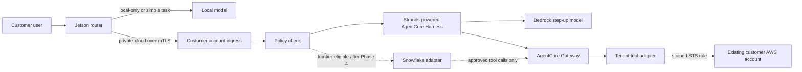

# Symphony implementation plan

For the short, checkable implementation queue, use [IMPLEMENTATION_CHECKLIST.md](IMPLEMENTATION_CHECKLIST.md). This file remains the detailed architecture and acceptance reference.

Symphony will give each customer a managed AWS account in Symphony's Organization and a Jetson device on site. Route each request to the least-expensive approved path that meets its measured quality, tool, and latency requirements: local AI first, a more capable private Bedrock model in that customer's AWS account when local is insufficient, and an explicitly permitted frontier model through Snowflake only when the customer needs capabilities the first two paths cannot provide economically or reliably. Complex reasoning, multi-step tool use, or a connector can justify evaluating the frontier path, but none automatically authorizes it. This is an implementation handoff for a new AWS environment: there is no existing Organization, landing zone, tenant account, or Snowflake integration to import. Build and verify the local and private AWS paths before starting Snowflake.

## Decisions for the first release

- **Tenant ownership and Regions:** Symphony owns the AWS Organization and the billing relationship. The Control Tower home Region and central services are in `us-east-1`. Each pilot customer gets a separate workload account, with its workload Region set to `us-east-1` or `us-east-2`. An AWS account is global; the Region choice applies to its deployed resources. The management, audit, log archive, and shared services accounts are separate from customer workloads. Customer accounts can be expanded into development and production accounts later.
- **Existing platforms:** A customer can connect an existing AWS account or other platform without moving it into Symphony's Organization. Access is scoped to approved resources and can be revoked by the customer. An existing AWS account uses a least-privilege cross-account role with a unique external ID; SaaS tools use per-customer OAuth credentials or APIs. Private on-premises systems can use a customer-hosted connector that initiates outbound connections.
- **Network:** The Jetson initiates outbound HTTPS with TLS to a customer-specific cloud endpoint. The implementation should use device identity and mutual TLS for the pilot, with a certificate allowlist and rotation process. Do not put the Jetson behind an inbound public listener. Add an encrypted application tunnel only for a connector that needs it. No Site-to-Site VPN, Tailscale, Kubernetes, or service mesh in the first release.
- **Models:** The local model handles simple work. The private-cloud step-up uses an eligible model through in-region Amazon Bedrock inference in the customer's allowed Region. Benchmark Kimi K2.5 and GLM 5 head-to-head for multi-step reasoning and tool use, with Qwen3 32B as an additional lower-cost baseline if still available; none is the chosen default. Bedrock model availability and invocation are Regional, not tied to a customer-selectable Availability Zone. Do not fine-tune on customer prompts. Snowflake is used only for the later, separately approved frontier path. A model's marketing label of "frontier-class" is not itself the route boundary: the private AWS route is defined by approved Bedrock data handling, regional inference, tenant isolation, and customer policy; the Snowflake route is defined by explicit permission for request data to leave the local/private AWS path for a separately governed frontier service. AWS states that Bedrock model providers cannot access customer prompts or completions; still review the current model terms and data-processing configuration before enabling one. Check model-specific retention, tool support, price, lifecycle, quotas, and regional availability.
- **Data routing:** Every request has an allowed data tier: `local-only`, `private-cloud`, or `frontier-eligible`. Within that ceiling, use the least-cost destination that meets an agreed task-quality threshold, necessary tool/connector capabilities, and a latency target. A connector or tool call does not automatically mean Snowflake: first test whether the tenant's private AgentCore tools and Bedrock model can complete the task. A failure never silently promotes data to a less private destination. Frontier access is off until the customer enables it and sets its policy, allowed models and connectors, and spend alerting.
- **Encryption:** TLS protects traffic. KMS-backed keys protect cloud data at rest; device storage encryption protects local data. KMS is not the transport encryption mechanism.
- **Cost:** Customers receive AWS budget alerts before and at their configured monthly amount. Snowflake usage has its own budget and alerts because it is billed separately. These are notifications, not an exact real-time spending cap.
- **Provisional Snowflake isolation:** When Phase 4 starts, use a separate Snowflake account for each customer that opts into frontier inference, under a Symphony-managed Snowflake organization. This keeps model access, budget attribution, and the account-level cross-region setting separate. Confirm this choice before provisioning Snowflake; it does not affect Phases 0–3.

## Service layout

| Area | First-release approach |
| --- | --- |
| AWS foundation | AWS Control Tower, Organizations, one customer workload account, audit and log archive accounts, and a separate shared services account. Keep Terraform ownership clear of Control Tower-managed resources. |
| People and portal | IAM Identity Center permission sets for AWS access. A later customer portal can use Cognito for application users and guided self-service. Avoid long-lived IAM user keys. |
| Edge | One Jetson service for local inference, routing, health reporting, configuration updates, and outbound TLS communication. Measure actual memory use and switching latency before adopting the proposed shared-weights/head-swap design. |
| Cloud inference | Start with in-region, on-demand Bedrock inference so idle pilot customers do not require dedicated GPU capacity. Benchmark Kimi K2.5 (`moonshotai.kimi-k2.5`) and GLM 5 (`zai.glm-5`) with identical multi-tool tasks in both permitted tenant Regions as applicable; retain Qwen3 32B (`qwen.qwen3-32b-v1:0`) as a cheaper baseline, not a default. Both Kimi and GLM support in-region `bedrock-runtime`/Converse in `us-east-1` and `us-east-2`; validate actual account access, tool reliability, p50/p95 latency, effective token cost, quotas, and terms before selection. |
| Agents and tools | Prefer the managed AgentCore Harness, whose agent loop is powered by Strands, in each tenant account. Attach that tenant's AgentCore Gateway and deploy Symphony/customer tool implementations as separately permissioned Gateway targets. Keep a custom Strands agent in AgentCore Runtime as a measured fallback if Harness cannot meet required control or latency targets. Add AgentCore Identity for delegated third-party credentials and Code Interpreter for sandboxed execution only when those tool types are introduced. Reusable code is deployed separately per tenant with separate roles, policies, and credentials. |
| Frontier inference | A separate Snowflake adapter with a model allowlist, region policy, customer opt-in, request attribution, and cost tracking. The initial tool-calling design has the Snowflake model return proposed tool calls to the tenant adapter, which authorizes and executes them through that tenant's approved Gateway targets. Snowflake cannot receive `local-only` or `private-cloud` content. Snowflake-native MCP connectors, if needed, are a separate per-connector approval and data-flow review. |
| Telemetry and security | CloudTrail and Config to log archive; GuardDuty/Security Hub in the audit/security account; OpenTelemetry traces and CloudWatch metrics for requests, agents, devices, and tool calls. Export only agreed security metadata to Symphony's SIEM. Do not log raw prompts or tool outputs by default. |
| Cost visibility | Per-customer AWS budget with forecast and actual-spend notifications; separate Snowflake budget; request-level model/token cost estimates in the router and customer reporting. |

Every request trace should carry a tenant ID, user ID, device ID, agent ID, model ID, tool ID when applicable, and a correlation ID. Tool permissions must be checked against both the tenant and the initiating user or agent. A trace should show why the router chose a destination without storing sensitive prompt text.

## AWS foundation and Terraform ownership

Create one AWS management account first; its root email, payment method, MFA, and recovery contacts are manual prerequisites. Control Tower's home Region is `us-east-1`, and its governed Regions include `us-east-1` and `us-east-2`. Use separate email addresses for the log archive and audit accounts, plus unique addresses for every new member account. Do not place agents, models, or customer data in the management account.

| Boundary | Account or OU | Responsibility |
| --- | --- | --- |
| Organization | Management account | AWS Organizations, Control Tower landing zone, consolidated billing, account vending, and organization-wide policies. |
| Security OU | Log archive account | Control Tower CloudTrail/Config archive, protected retention, and restricted log access. |
| Security OU | Audit account | Delegated security administration, findings, and investigation roles. |
| Infrastructure OU | Shared services account | Symphony operations, deployment automation, shared software artifacts, and SIEM export. It holds no tenant prompt or connector credential by default. |
| Customers OU | One account per customer | Regional API endpoint, Bedrock access, AgentCore, tenant tools, tenant secrets and keys, and tenant metrics. Start with one account and one primary Region per customer. |
| Sandbox OU | Integration fixture account | A low-cost second account with a sample S3 bucket for cross-account tests until a real customer-owned account is available. It does not prove cross-Organization billing or policy behavior; repeat those tests during real onboarding. |

Terraform owns the Organization structure that Control Tower does not create, the Control Tower landing zone declaration, optional controls, budgets, delegated security configuration, and resources that Symphony explicitly adds to member accounts. Control Tower owns the baseline resources and OUs it creates. Reference those existing resources rather than declaring duplicates; do not import generated baseline resources into tenant Terraform state or edit them outside Control Tower. Pin the Terraform and AWS provider versions and commit the dependency lock file. The installed tools on this workstation are Terraform 1.16.4 and AWS CLI 2.33.30; Claude should recheck versions when implementation starts.

Bootstrap in this order:

1. Preflight the intended management account with `aws sts get-caller-identity`, confirm `us-east-1`, account emails, service quotas, and that no Organization or landing zone already exists. Refuse to apply if the account ID differs from the configured management ID.
2. Create the Organization with all features, the Security OU, and the dedicated audit and log archive accounts. Put both in the required service-integration OU before creating the landing zone. Create Customers, Infrastructure, and Sandbox OUs only through the supported Control Tower workflow or register them before applying controls.
3. Create a versioned, KMS-encrypted S3 Terraform backend in the management account with state locking and restricted access. This is administrative state storage, not a customer workload. Bootstrap state may be local briefly; document and verify migration to the remote backend before any tenant deployment. Never commit state, plans containing secrets, account root credentials, or generated certificates.
4. Create the Control Tower landing zone with Terraform's `aws_controltower_landing_zone` resource using a checked-in manifest. Pin the landing zone version supported at implementation time; keep the manifest and chosen Regions explicit. Wait for the operation to be healthy before provisioning accounts.
5. Provision shared services and the pilot customer account with Account Factory; apply the separate Terraform baseline to each account. Use Account Factory for the pilot. Consider Account Factory for Terraform only when onboarding volume justifies its extra management account and pipeline.

Keep state separate for bootstrap, organization, shared services, each tenant baseline, each tenant workload, and the optional external-account integration template. Use an explicit provider `assume_role` target and expected account ID for each root. A plan must fail rather than target the wrong account or Region. Runs should be repeatable without replacing accounts, KMS keys, log buckets, or Control Tower-managed resources.

## Request path and data contract

The first two running destinations are local inference on the Jetson and private cloud inference in the customer's Symphony account. The Snowflake destination is absent until its later phase. The device may suggest a route, but a deterministic policy must enforce destination and tool permissions; model output is never authorization.



| Data tier | Allowed destination | Default behavior |
| --- | --- | --- |
| `local-only` | Jetson only | No prompt, retrieved content, or tool input leaves the device. If the local model cannot answer, return an explicit limitation. |
| `private-cloud` | Jetson or that customer's AWS account | Default for ordinary pilot requests. May use approved tenant tools; never call Snowflake. |
| `frontier-eligible` | Jetson, tenant AWS, or opted-in Snowflake model | Prefer local or private AWS when they meet the task's requirements. Use Snowflake only after the customer enables a specific frontier model, approved tool/connector set, and regional/data policy. |

Implement destination choice as a policy decision, not a prompt instruction. For a `frontier-eligible` request, the router still evaluates local and private AWS capability first. Snowflake is eligible only when (1) the customer has enabled the route for this user/workload and data category, (2) the requested model and every tool/connector are allowlisted, (3) a tested local/private path cannot meet the task's quality, tool coverage, or agreed latency requirement, and (4) the estimated request cost and current customer spend policy permit it. Record which condition caused escalation. Budget notifications are not an exact hard stop, so any customer-configured hard per-request or daily guardrail must be enforced by the router's own metering and must fail closed when usage cannot be determined. The router must never send a request to Snowflake solely because a model asks for it, a tool fails, or the customer has a connector.

Use a versioned request envelope containing `request_id`, authenticated user subject, device ID, conversation ID, requested data tier, permitted tool IDs, deadline, and message content. Derive the tenant ID from device registration and cloud authentication; do not trust a tenant ID supplied only in the body. Server policy may raise the privacy level or remove destinations/tools, but cannot be weakened by a classifier result or tool output. Record policy version, selected destination, and reason code with the trace. Do not record messages in routine access logs.

Expose a versioned `POST /v1/requests` cloud API and a local equivalent. A successful response includes `request_id`, answer, selected destination, model ID, policy version, and usage/latency metadata; a failure has a stable error code such as `DEVICE_REVOKED`, `USER_UNAUTHORIZED`, `DATA_TIER_DENIED`, `TOOL_DENIED`, `MODEL_UNAVAILABLE`, or `UPSTREAM_TIMEOUT`. Use an idempotency key for retried requests so an agent does not repeat a write-capable tool call later. Define JSON schemas and example requests in `schemas/`; never require an arbitrary account ID, role ARN, or external URL from the model to choose a tool target.

The local service should run on an ARM64 Jetson image with a pinned model artifact, checksum, quantization, license record, and a systemd-managed container or process. It should support health checks, signed configuration updates, last-known-good configuration, and rollback. Start with one quantized small instruct model that fits the actual Jetson memory budget; measure first-token latency, tokens per second, peak memory, thermal behavior, and concurrent-request behavior. Treat the shared-weights/head-swap classifier as an experiment: ship a simpler rules-plus-small-classifier route first if the swap does not show a measured benefit.

For the cloud path, use a Regional API Gateway endpoint with a custom domain and mTLS truststore. Disable the default `execute-api` hostname so the custom-domain certificate check cannot be bypassed. The device presents its own client certificate; an authorizer checks the certificate identity against an active device registry and maps it to exactly one tenant. For the pilot, issue a distinct certificate per device from a pilot CA whose private key is kept outside Git and Terraform state; the Jetson generates its own private key and sends a CSR. Keep the CA certificate in a versioned S3 truststore and the issued certificate fingerprint, serial, tenant, device ID, status, and expiry in a tenant registry. Allow brief certificate overlap for rotation; revoke by marking the old serial inactive in the registry. API Gateway's truststore validation alone does not check revocation. Use a minimal Cognito user pool for pilot end-user JWTs, with external OIDC federation as an onboarding option later. The cloud ingress validates both the device and the user, rechecks the data tier and tool allowlist, then invokes the tenant's AgentCore Harness using its dedicated execution role. The Harness calls in-region Bedrock inference and only the tenant's approved Gateway tools.

Failures are explicit: `local-only` stays local, an unavailable private cloud request returns a retryable error or an approved local answer, and no failure causes automatic Snowflake routing. Set request and tool timeouts, bounded retries only for idempotent operations, and a per-tenant concurrency limit. A customer can disable cloud or frontier routing without removing local service.

Configure the Harness with the Bedrock model ID and `converse_stream` in the tenant Region. Run an initial integration smoke test with Kimi K2.5 and GLM 5, then the head-to-head tool benchmark; optionally include Qwen3 32B as a cost baseline. This is model evaluation, not a commitment to serve all three in production. Do not enable cross-Region inference profiles by default. Confirm every candidate and AgentCore feature is available in the chosen tenant Region and account during preflight; Bedrock does not let the caller select an Availability Zone for managed inference, and changing AZ does not change the Regional model catalog. If tenant-owned VPC resources or AgentCore VPC connectivity are introduced, select supported subnets across AZs separately from model selection. Store model IDs, endpoint/API type, and policy in versioned tenant configuration so the benchmark winner can be selected without changing routing code. Review each model's data-retention mode and terms; do not claim that open weights alone prevent provider-side retention or training.

## Connecting a customer's existing systems

The new Symphony-managed customer account is the execution boundary for its agents and connectors. An existing customer account or cloud project remains under the customer's ownership and billing. Each connection grants access to selected resources; it does not join that account to Symphony's Organization.

| Existing system | Connection from the Symphony tenant account |
| --- | --- |
| AWS APIs and resources | Deploy a tool adapter in the tenant account. The customer creates a narrow role in its existing AWS account that trusts only the tenant's connector role and requires a unique external ID. The adapter assumes that role for each approved operation and receives temporary credentials. Where useful, pass a controlled source identity so CloudTrail attributes actions to the agent or request. |
| AWS events | The customer forwards selected events to a tenant-specific EventBridge bus with a policy allowing only its account and agreed event sources. Keep event payloads within the customer's permitted data tier. |
| Existing private AWS application | Prefer an authenticated HTTPS API if the customer already exposes one. If it must remain private, evaluate PrivateLink for that specific service and account for endpoint charges. An IAM role alone does not provide network access to private VPC addresses. |
| Azure, Google Cloud, or SaaS | Use the platform's HTTPS API with OAuth or workload identity federation where supported. Give each customer a separate identity and permission scope. A private application can run a customer-hosted connector that calls outward over TLS. |

The tenant's AgentCore Gateway exposes only approved connector operations. An agent's request passes through tenant/user authorization before the adapter accesses the customer's system. The customer can revoke the role, OAuth grant, or event-bus permission without deleting its Symphony account. AWS Budgets in Symphony cover the new managed account; spending in the customer's existing AWS account remains under that account's own billing and alerts unless the customer separately grants cost-report access.

### First AWS connector specification

Build a read-only S3 connector as the reference implementation; replace the bucket with the pilot customer's chosen AWS resource if S3 is not useful to them. This connector is a tool adapter in the Symphony tenant account, not a role shared by every customer.

1. Symphony creates a dedicated `connector-execution` role in that tenant account. Only the approved adapter can use it. Its cross-account permission is limited to `sts:AssumeRole` on the one integration role ARN supplied by the customer.
2. The customer deploys a small Terraform module or CloudFormation stack in its existing account. It creates a `SymphonyIntegrationRole` whose trust policy names the exact tenant connector role and requires a unique, generated external ID. The customer reviews the role's resource permissions before applying it. The external ID is an additional trust condition, not a secret or a substitute for the exact principal.
3. For the S3 reference tool, the customer role allows `s3:ListBucket` on the chosen bucket with an approved-prefix condition and `s3:GetObject` only for objects under that prefix. If the bucket uses a customer-managed KMS key, the role permissions and key policy must permit the necessary decrypt operation. No write, delete, or broad account-discovery permissions are included.
4. The agent calls a named operation exposed by its tenant's AgentCore Gateway. The adapter checks tenant, user, agent, and tool policy, then calls STS to assume the customer role. It uses a controlled source identity or session name that can be joined to Symphony's trace ID; if using source identity, the role trust and caller policy must grant `sts:SetSourceIdentity`. It retrieves only the data needed for the request and returns it to the tenant agent; bulk replication is a separate, explicit integration.
5. Symphony records the request ID, assumed role, action, resource, outcome, and time without raw object contents. The customer keeps its own CloudTrail records; enable S3 data events for the approved bucket if object-level reads need to appear there. Correlate the records through the controlled source identity or role session name. The customer can remove the trust policy or delete the integration role to revoke access.

The setup must prove both directions of the boundary: an approved read succeeds, while access to another bucket or prefix, writes, use of the wrong external ID, and calls from another tenant fail. The customer retains its own Organization policies and existing-account bill. The Symphony tenant account pays for its agent and connector workload.

The first tool contract should be narrow: `list_documents(relative_prefix, limit)` and `read_document(key)` operate only under the configured bucket and prefix. Cap list results and returned text bytes, reject non-text objects and path/prefix escapes, and return a truncation flag when limits apply. Bucket name, prefix, role ARN, and external ID are deployment configuration, not model-supplied inputs. Use synthetic documents and one deliberately forbidden prefix for the acceptance test.

## Agents, tools, and authorization

Create one managed, Strands-powered AgentCore Harness per tenant for the pilot. It runs inside AgentCore Runtime; do not also deploy a second custom Runtime agent for the same pilot path. Give the Harness a tenant-specific IAM execution role with only the approved Bedrock model and Gateway permissions. Use a stable agent ID in traces and carry the initiating user subject through the request; Gateway sees the Harness role, not an authenticated end-user identity. The first S3 tool is therefore tenant-wide read-only over one approved resource scope. If users within a tenant require different tool permissions, do not enable that target until a verified, non-model-controlled end-user identity propagation mechanism exists; ingress authorization alone cannot make a tenant-wide Gateway Lambda enforce per-user access. Configure the Gateway for IAM-authenticated calls from that Harness role and allow only the tenant's approved targets. The first target is a Lambda-backed read-only S3 adapter in that tenant account; the Harness never receives the customer's STS credentials. AgentCore Identity can hold OAuth credentials for later non-AWS connectors; do not create shared cross-tenant OAuth secrets.

Define an explicit Harness `allowedTools` list containing only the required Gateway tool names for the request. The managed Harness exposes `shell` and `file_operations` by default if the list is omitted; do not enable them for the pilot. Do not grant the invoking principal `bedrock-agentcore:InvokeAgentRuntimeCommand`, which is outside the `allowedTools` control. Set bounded `maxIterations`, `maxTokens`, and `timeoutSeconds` values based on pilot task tests. Explicitly disable persistent AgentCore Memory for the stateless first pilot; add it later only with customer-approved retention and actor/session isolation. Avoid client-side Harness inline functions on the hot path because they pause the invocation and require the caller to send the tool result in another request. Use Gateway targets for ordinary tools, and reserve inline functions for human approval or a justified client-side action.

The first tool targets should be small, read-only, and Regional: Gateway and Lambda in the same tenant Region as the Harness. Keep schemas and returned text compact. Start with `list_documents` and `read_document`, then measure each model turn and Gateway/Lambda/STS span before adding more tools. If a trace shows Gateway or Harness overhead prevents a latency target, run the same task with a custom Strands agent on Runtime using the same Gateway target and, separately, a local `@tool` implementation; retain Gateway's policy and isolation unless the measured benefit and replacement controls justify the change. Do not assume the custom Runtime path is faster without an A/B measurement.

Define each tool with a versioned manifest: tool ID and semantic version, owner, input/output JSON schemas, data tier allowed, target account/Region, resource scope, authentication type, timeout, whether it is idempotent, whether it can write or delete, and whether human approval is required. Validate inputs before invoking the target and cap output size before feeding results back to a model. Returned documents and web content are untrusted data, not instructions that can widen tool permissions.

Reusable Symphony tools are built once and deployed separately into tenant accounts with separate roles, credentials, policies, and logs. Customer-authored tools are published only to that customer's catalog by default. Publication should include static checks, a sandbox test, manifest review, version pinning, and a rollback path. Browser and shell/code tools are disabled for the first read-only pilot; when enabled later, use AgentCore Browser and Code Interpreter sessions with explicit network, file, duration, and IAM limits. Do not expose a general-purpose shell running under the tenant administrator role.

## Security, logging, and spend controls

Use IAM Identity Center for Symphony operators and customer AWS administrators, with permission sets scoped to the right accounts. Require MFA for privileged access. Keep a documented break-glass process and protect root users. Customer self-service may assign approved permission sets within its account; it cannot change Organization, logging, security, billing, or cross-tenant resources. Start with least-privilege roles and region/service guardrails in customer OUs. Protect log buckets, KMS keys, and critical resources against accidental deletion through Terraform lifecycle controls and applicable AWS organization controls.

Centralize CloudTrail management events and AWS Config through Control Tower. Enable GuardDuty and Security Hub with a delegated security administrator. Add only the S3 object data events needed for the pilot connector, because high-volume data-event logging has cost. Give operational metrics and traces a retention period; keep security logs longer according to the pilot agreement. Separate SIEM export into security metadata and explicitly approved content, with no raw prompts, tool outputs, bearer tokens, or secrets in default traces. Token counts are allowed as metrics. Test that AgentCore instrumentation does not add payloads to spans unexpectedly.

Track device uptime, model load failures, memory and temperature, local/cloud route counts, request latency, Bedrock input/output tokens, tool errors, authorization denials, and connector revocations. The trace key must link edge, ingress, agent, Gateway, Lambda adapter, and customer AWS role session. Emit a policy-decision event for every cloud or frontier route, including model, reason, and policy version. Alarm on device offline, elevated errors, denied cross-tenant attempts, missing logs, and unusual model/tool spend.

Create an AWS cost budget for each managed customer account from the management account, filtered to that linked account. Default notifications are 80% forecast, 80% actual, and 100% actual of a customer-configured monthly amount, delivered to the customer billing contact and Symphony operations. Verify the notification destination with a controlled SNS or email-delivery test and inspect the budget subscription; use a temporary low-threshold sandbox budget if an end-to-end budget notification test is needed. Also track Bedrock request volume and token-based estimated cost in the tenant router so operators can spot a spike before billing data catches up. Do not describe AWS Budgets as a hard cap. Snowflake will get separate budgets and usage attribution when its phase begins; the customer's pre-existing account keeps its own billing and alerts unless it opts into reporting.

## Repository deliverables for implementation

Keep the executable work under `cloud/` and make the plan's phase boundaries visible in the repository. This is the target layout; implementation can adjust package names without changing account and trust boundaries.

```text
cloud/
  PLAN.md
  terraform/
    bootstrap/              # Organization prerequisites and remote state
    landing-zone/           # Control Tower manifest and resource
    organization/           # OUs, controls, delegated security, budgets
    tenant-baseline/        # IAM, KMS, logs, device registry, regional baseline
    tenant-workload/        # API ingress, Bedrock access, AgentCore, tools
    external-aws-connector/ # Customer-applied role and S3 permission template
    modules/                # Small reusable units with explicit inputs/outputs
  edge/                     # ARM64 local router, model runtime, enrollment
  services/
    ingress/                # Certificate/user auth and server-side route policy
    agent/                  # Harness configuration, model comparison, Runtime fallback prototype
    tools/                  # Customer tool catalog, schemas, Lambda adapters, tests
    snowflake/              # Added only in the gated frontier phase
  schemas/                  # Versioned request, response, policy, tool manifest
  tests/                    # Policy, account isolation, tool, and end-to-end checks
  runbooks/                 # Bootstrap, deploy, rotate, revoke, recover, teardown
```

Every Terraform root needs a README stating account/Region, prerequisites, inputs, outputs, state key, apply order, expected cost-bearing resources, and what Control Tower owns. Expose account IDs, role ARNs, endpoint DNS names, and KMS key ARNs as outputs; never output secrets or private keys. Use variables for customer ID, primary Region, budget amount and recipients, allowed model IDs, domains, and retention. Store secrets in a tenant-specific secret store with KMS encryption, not in Terraform variables or Git. CI should run formatting, validation, static policy checks, unit tests, and a reviewed plan before any apply; destructive plans require explicit human review.

Terraform may create a Secrets Manager secret container, but inject the secret value through an enrollment or rotation process outside Terraform so it never enters state. Add `prevent_destroy` and a documented break-glass procedure for the state bucket, log archive, KMS keys, and customer accounts. The tenant workload root should create the Regional API Gateway custom domain and authorizer, device registry, Cognito pilot identity, AgentCore Harness and Gateway, Lambda tool adapter, IAM roles, log groups, alarms, and their policy bindings. The customer-applied connector root should create only the reviewed role and resource policy; it must never require the customer's root credentials or expose broad administrator permissions.

For the public HTTPS pilot path, avoid a NAT gateway and private VPC attachment unless a tenant workload actually needs private network access. Apply WAF and API rate limits at the regional ingress, plus per-user and per-device request quotas in the application. This keeps the public API narrow without adding a full network mesh. PrivateLink is an optional connector-specific design with its own cost review, not a default tenant dependency.

## Build sequence and acceptance gates

The phases below are ordered. Claude may implement code for later phases in separate branches, but Snowflake must not be deployed or enabled until both the local path and the private AWS model plus AgentCore path have passed their gates. Each phase ends with a short evidence report: deployed account/Region, Terraform plan and outputs, test results, observed cost-bearing resources, and open defects. No phase is complete merely because Terraform applied.

### Phase 0. Pilot decisions and safety baseline

Choose a pilot tenant ID, a primary workload Region (`us-east-1` or `us-east-2`), a monthly AWS budget and recipients, domain/DNS ownership, and one Jetson device. For a start-from-scratch demo, create a synthetic customer and a Sandbox OU integration fixture account; use no real customer data. Gather unique AWS account emails and a management account with billing and administrative access. Estimate the monthly baseline for shared accounts, CloudTrail/Config, GuardDuty, API Gateway, AgentCore, Bedrock, logs, and the fixture before applying the landing zone. Define representative local-only, private-cloud, cross-account tool, and forbidden-route tasks. Write the threat model for device loss, prompt injection, tool abuse, cross-tenant access, credential theft, logs, and frontier egress.

**Gate:** The chosen Region, account emails, budget contacts, cost estimate, device enrollment method, tool permissions, and evaluation examples are recorded. There are no real account IDs, access keys, private keys, or customer documents in Git.

### Phase 1. Create and verify the AWS landing zone

Apply the bootstrap and landing-zone Terraform roots in order. Establish the Organization, Control Tower, shared security accounts, OUs, Terraform state backend, delegated security services, and the first customer account. Apply tenant baseline controls, KMS keys, logging, identity assignments, initial Cognito user pool, and the customer budget. Use the selected tenant Region for workload resources and `us-east-1` for central resources. Configure one budget test notification and an audit query. Capture AWS account IDs as protected deployment outputs, not hard-coded source values.

**Gate:** Control Tower reports a healthy landing zone; the pilot account and fixture account are in registered OUs; `terraform plan` is stable on a second run; log archive receives a management event; a test security finding and budget notification reach the intended contacts; an Identity Center user can enter only the assigned account; and the management account hosts no customer workload.

### Phase 2. Implement and validate local inference

Package the Jetson runtime, small model, deterministic routing policy, config updater, device metrics, and local request interface. Test the local model with representative simple tasks and record p50/p95 latency, first-token time, throughput, peak memory, and behavior during network loss. Run the head-swap experiment separately; keep it only if it improves measured routing and generation latency within memory limits. Verify that local-only requests never leave the device, including telemetry payloads.

**Gate:** The device answers the agreed simple-task set at the chosen quality and latency targets; survives restart and network outage; rejects an invalid config signature; reports health when connected; and has a documented install, update, certificate, and rollback procedure. This gate must pass before frontier work.

### Phase 3. Implement and validate private AWS inference and tools

Deploy the per-tenant mTLS API endpoint, device registry and authorizer, user authentication, ingress policy, managed AgentCore Harness, Gateway, Bedrock model configuration, and read-only S3 tool adapter. Configure the Harness with `converse_stream`, an explicit Gateway-only tool allowlist, disabled persistent memory, and bounded execution limits. Smoke-test Kimi K2.5 and GLM 5 in the same tenant Region; optionally include Qwen3 32B as a lower-cost baseline. Connect the Jetson's private-cloud route to this endpoint. Use the fixture account to exercise the customer-applied cross-account role template. Test certificate revocation, an invalid user token, wrong-tenant requests, denied bucket/prefix access, denied writes, wrong external ID, disabled tool, direct Runtime command permission denial, missing model permission, and customer role revocation. Trace one successful request end-to-end and compare it with CloudTrail.

Benchmark each candidate against the same pilot tasks, tool schemas, Harness settings, Region, and local baseline. Include single-tool, repeated-tool, invalid-tool, and interrupted/retried requests. Record answer quality, tool-call correctness, p50/p95 time to first token and completion, model-turn duration, Harness/Gateway/Policy/Lambda/STS spans, cold versus warm behavior, input and output tokens, cost per completed task, failure rate, and effective context window. Do not infer that one model or the custom Runtime path is faster from specifications alone. Select the least-cost model that meets the agreed quality, tool, latency, privacy, and reliability thresholds; allow a separate code-specialist model only if the measured benefit justifies its cost and routing complexity. Record the choice and rejected candidates in an evaluation report. Set model and concurrency limits so a runaway agent cannot make unbounded calls.

**Gate:** The private-cloud path works in the chosen tenant Region with an attributable trace, the customer-controlled connector can be revoked, all negative authorization tests fail closed, logs omit raw prompts and object contents, and a budget/usage report is available. The pilot's tenant-wide document scope is recorded; if the test tenant has per-user resource differences, a trusted user-identity propagation design and negative cross-user tests must pass before that tool is exposed. Both Phase 2 and Phase 3 must pass before frontier implementation starts.

### Phase 4. Add the optional Snowflake frontier path

Start this phase only after the Phase 2 local and Phase 3 private AWS gates have passed with recorded evidence. Provision one dedicated Snowflake account for the pilot tenant under a Symphony Snowflake organization, subject to confirmation of the provisional isolation choice above. Use the Cortex REST Chat Completions API (`/api/v2/cortex/v1/chat/completions`) behind a tenant adapter; select a model that currently supports tool calling through that API. Snowflake currently documents tool calling for OpenAI and Claude models, so verify the chosen model's API support again at implementation time. Prefer short-lived OAuth or key-pair authentication over a long-lived PAT where supported. Give the adapter a dedicated service user and only the role needed for REST inference, removing broader default grants if necessary. Allowlist approved frontier model IDs; query Snowflake's current model list rather than embedding an assumed permanent model name. Keep the Snowflake route disabled until the customer explicitly opts in. Check each model's terms, region/cross-region processing, retention, and current price. Set Snowflake's account-level cross-region inference policy to the approved boundary. Bind Snowflake request IDs and `CORTEX_REST_API_USAGE_HISTORY` records to Symphony request IDs. Configure a separate Snowflake budget and alert recipient; the AWS budget does not cover Snowflake charges.

For the initial complex-tool path, the tenant adapter sends only approved tool schemas and the minimum necessary request content to Snowflake. Snowflake returns a proposed function call; the adapter validates tool name and arguments against the same tenant/user/data-tier policy used for private AWS, invokes the approved tenant Gateway target, caps and filters the result, and sends it back to the Snowflake model only if that result is independently classified as `frontier-eligible`. Snowflake does not receive customer AWS credentials or arbitrary connector endpoints, and a model-supplied account ID, role ARN, or URL never selects a target. If a tool result contains newly retrieved `local-only` or `private-cloud` data, stop the frontier tool loop; any reclassification requires a separate customer policy change outside that request. Do not assume that a connector available to a private Harness agent must be exposed to Snowflake. Snowflake-native Cortex Agents/MCP connectors can be evaluated later for a customer who needs them, but require a separate connector-specific consent, OAuth scope, egress, residency, audit, and cost review before use.

Replay eligible and ineligible requests, including a tool call whose arguments point outside an approved resource and a tool result containing content that is not approved for frontier egress. The adapter must reject `local-only` and `private-cloud` data before any network call. Measure frontier quality, tool-call success, p50/p95 latency, and total cost per completed task against the private AWS path, then set a customer-visible routing threshold. If a Snowflake request fails, return a clear error or use a destination still permitted by policy; do not retry through another frontier provider automatically.

**Gate:** Explicitly eligible requests reach only an approved frontier model and approved tools; prohibited requests and tool results produce no Snowflake call; regional and budget settings are verified; usage is attributable per tenant; private/local paths remain the default for tasks they can satisfy; and the customer can disable the route immediately.

### Phase 5. Repeatable onboarding and self-service

Automate account creation, tenant baseline deployment, edge enrollment, certificate renewal and revocation, model/tool selection, and budget recipient updates. Package the external AWS role as customer-reviewed Terraform and CloudFormation options with a connection test and removal instructions. Add customer portal views for users, approved resources, usage, alerts, and integration health. Add browser, code, write-capable, and non-AWS connectors only with separate permissions and human approval where needed.

**Gate:** Onboard a second synthetic tenant with no copied credentials or manual IAM edits; verify isolation of models, tools, keys, logs, budgets, and connector roles; tear down its optional workload safely while retaining required audit records.

## Items to set before implementation

- An AWS management account with billing access, MFA, and unique email addresses for the shared and pilot accounts. Symphony has no existing Organization or landing zone to import.
- DNS domain for the pilot API, a pilot Jetson device, and access to its software image. Default the synthetic pilot workload to `us-east-1` if there is no customer residency reason to choose `us-east-2`; validate the tenant modules in both allowed Regions before offering both to customers.
- Monthly AWS budget amount, customer billing contact, and Symphony operations contact. Use the 80% forecast, 80% actual, and 100% actual notification defaults until the customer changes them.
- Local model and representative task set; the head-swap idea remains an experiment until measured on the Jetson.
- A real external AWS account or existing cloud platform for a later customer trial. The sandbox fixture proves mechanics first, but cannot substitute for a cross-Organization onboarding test.
- Confirm the provisional per-customer Snowflake account choice before Phase 4. The frontier route remains off until the local and private AWS acceptance gates pass and a pilot customer opts in.

## Relevant service behavior

- [AWS Control Tower landing zone and account structure](https://docs.aws.amazon.com/controltower/latest/userguide/how-control-tower-works.html)
- [Control Tower shared-account prerequisites](https://docs.aws.amazon.com/controltower/latest/userguide/configure-shared-accounts.html), [Account Factory for Terraform scope](https://docs.aws.amazon.com/controltower/latest/userguide/aft-overview.html), and [Terraform landing-zone resource](https://registry.terraform.io/providers/hashicorp/aws/latest/docs/resources/controltower_landing_zone)
- [Terraform S3 backend locking and versioning](https://developer.hashicorp.com/terraform/language/backend/s3)
- [AWS Budgets actions and thresholds](https://docs.aws.amazon.com/cost-management/latest/userguide/budgets-controls.html)
- [AWS guidance for third-party cross-account roles and external IDs](https://docs.aws.amazon.com/IAM/latest/UserGuide/id_roles_common-scenarios_third-party.html)
- [AWS source identity in assumed-role activity](https://docs.aws.amazon.com/IAM/latest/UserGuide/id_credentials_temp_control-access_monitor.html), [cross-account EventBridge](https://docs.aws.amazon.com/eventbridge/latest/userguide/eb-cross-account.html), and [PrivateLink service sharing](https://docs.aws.amazon.com/vpc/latest/privatelink/privatelink-share-your-services.html)
- [CloudTrail S3 object-level data events](https://docs.aws.amazon.com/awscloudtrail/latest/userguide/logging-data-events-with-cloudtrail.html)
- [Google Cloud workload identity federation](https://docs.cloud.google.com/iam/docs/workload-identity-federation) and [Microsoft Entra workload identity federation](https://learn.microsoft.com/entra/workload-id/workload-identity-federation)
- [Bedrock regional model availability](https://docs.aws.amazon.com/bedrock/latest/userguide/models-region-compatibility.html), [model endpoint availability](https://docs.aws.amazon.com/bedrock/latest/userguide/models-endpoint-availability.html), and [model-specific retention](https://docs.aws.amazon.com/bedrock/latest/userguide/data-retention.html)
- [Qwen3 32B](https://docs.aws.amazon.com/bedrock/latest/userguide/model-card-qwen-qwen3-32b.html), [Qwen3-Coder-30B-A3B-Instruct](https://docs.aws.amazon.com/bedrock/latest/userguide/model-card-qwen-qwen3-coder-30b-a3b-instruct.html), [Ministral 14B 3.0](https://docs.aws.amazon.com/bedrock/latest/userguide/model-card-mistral-ai-ministral-14b-3-0.html), and [Gemma 4 26B-A4B](https://docs.aws.amazon.com/bedrock/latest/userguide/model-card-google-gemma-4-26b-a4b.html) model cards; [AgentCore regional support](https://docs.aws.amazon.com/bedrock-agentcore/latest/devguide/agentcore-regions.html) and [VPC AZ support](https://docs.aws.amazon.com/bedrock-agentcore/latest/devguide/agentcore-vpc.html)
- [API Gateway mutual TLS requirements and certificate behavior](https://docs.aws.amazon.com/apigateway/latest/developerguide/rest-api-mutual-tls.html)
- [AgentCore Harness versus Runtime](https://docs.aws.amazon.com/bedrock-agentcore/latest/devguide/harness-vs-runtime.html), [Harness tools and allowlists](https://docs.aws.amazon.com/bedrock-agentcore/latest/devguide/harness-tools.html), [Harness model configuration](https://docs.aws.amazon.com/bedrock-agentcore/latest/devguide/harness-models.html), and [Harness Memory defaults](https://docs.aws.amazon.com/bedrock-agentcore/latest/devguide/harness-memory.html)
- [Kimi K2.5](https://docs.aws.amazon.com/bedrock/latest/userguide/model-card-moonshot-ai-kimi-k2-5.html), [GLM 5](https://docs.aws.amazon.com/bedrock/latest/userguide/model-card-zai-glm-5.html), [Bedrock pricing](https://aws.amazon.com/bedrock/pricing/), and [Bedrock data protection](https://docs.aws.amazon.com/bedrock/latest/userguide/data-protection.html)
- [AgentCore observability](https://docs.aws.amazon.com/bedrock-agentcore/latest/devguide/observability.html), [Gateway outbound authorization](https://docs.aws.amazon.com/bedrock-agentcore/latest/devguide/gateway-outbound-auth.html), and [Gateway performance guidance](https://docs.aws.amazon.com/bedrock-agentcore/latest/devguide/gateway-advanced-performance.html)
- [Snowflake AI cost management](https://docs.snowflake.com/en/user-guide/snowflake-cortex/governance-and-availability/ai-cost-management-and-governance) and [cross-region inference](https://docs.snowflake.com/en/user-guide/snowflake-cortex/cross-region-inference)
- [Snowflake Cortex REST API, tool calling, authorization, and usage history](https://docs.snowflake.com/en/user-guide/snowflake-cortex/cortex-rest-api) and [Cortex Agents MCP connectors](https://docs.snowflake.com/en/user-guide/snowflake-cortex/cortex-agents-mcp-connectors)
