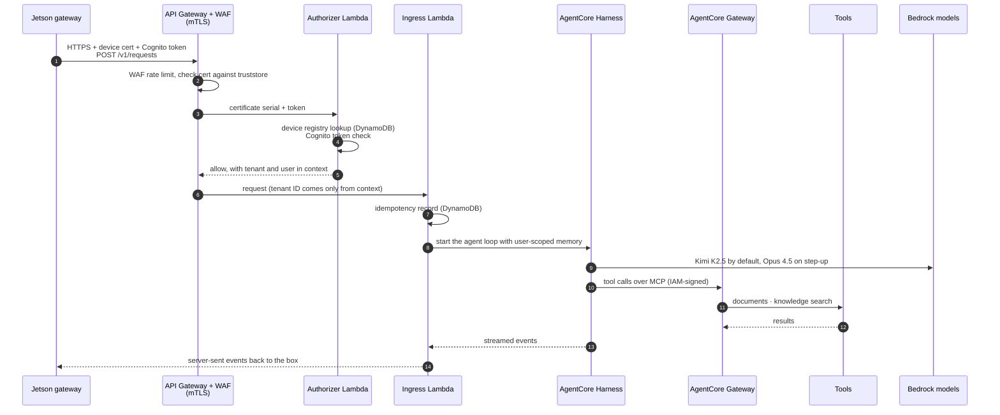

# Symphony AWS environment, as built

This page records the AWS environment we actually deployed for the hackathon
demo: which accounts existed, what ran in each one, and how the pieces worked
together on a request. It was deployed on 2026-10-11 and torn down on
2026-10-12 (see [Teardown](#teardown)). For the design and the reasoning
behind it, see [`aws-infrastructure.md`](aws-infrastructure.md), the
[project README](../../README.md#orchestra-and-the-aws-platform) and
[`docs/design/cloud/PLAN.md`](../design/cloud/PLAN.md).

The inventory below comes from the eight Terraform state files at the moment
of teardown: 258 resource instances in total. Account IDs and contact emails
are left out on purpose.

## Accounts and organizational units

Symphony ran inside an existing AWS Organization. Bootstrap adopted that
organization instead of creating a new one, so the two accounts that were
already there (development and production) stayed untouched and ungoverned.

| Account | OU | What it was for | Created by |
| --- | --- | --- | --- |
| Management | (root) | Organizations, Control Tower, IAM Identity Center, Route 53 domain, Terraform state | Existing |
| Log Archive | Security | Organization CloudTrail and AWS Config logs (Control Tower) | `bootstrap/` |
| Audit | Security | Delegated admin for GuardDuty, Security Hub and Config; finding alerts | `bootstrap/` |
| Shared Services | Infrastructure | Encrypted build-artifacts bucket | `organization/` (Account Factory) |
| Customer Demo | Customers | The `demo` tenant: Orchestra, its data and its users | `organization/` (Account Factory) |
| Integration Fixture | Sandbox | Stands in for a customer's own AWS account that holds documents | `organization/` (Account Factory) |

Regions: all workloads ran in `us-east-1`. Control Tower governed `us-east-1`
and `us-east-2`, so GuardDuty, Security Hub and finding alerts ran in both.

## What each Terraform root deployed

| Root | Account | Instances | What was in it |
| --- | --- | --- | --- |
| `bootstrap/` | Management | 20 | Adopted organization, Security OU, Log Archive and Audit accounts, three Control Tower service roles, KMS key and versioned S3 bucket for Terraform state |
| `landing-zone/` | Management | 3 | Control Tower landing zone 4.0 (org CloudTrail, Config, Identity Center, 365-day log retention) and its KMS key |
| `organization/` | Management + Audit | 84 | Control Tower baselines on the Customers, Infrastructure and Sandbox OUs; three SCPs; GuardDuty and Security Hub with Audit as delegated admin; finding alerts; Identity Center groups and permission sets; the tenant budget |
| `shared-services/` | Shared Services | 12 | Artifacts bucket and KMS key, account hygiene |
| `tenant-baseline/` | Customer Demo | 8 | Tenant KMS key, Cognito user pool, device registry table, application log group, account hygiene |
| `sandbox-fixture/` | Integration Fixture | 16 | Documents bucket and KMS key with five sample documents, account hygiene |
| `tenant-workload/` | Customer Demo (+ one record in Management) | 113 | Orchestra: the API, agent, tools, memory, knowledge base and observability (detailed below) |
| `external-aws-connector/` | Integration Fixture | 2 | Read-only cross-account role for Orchestra's document tool |

"Account hygiene" is the `account-hygiene` module in every member account:
an IAM Access Analyzer, EBS encryption by default, and an account-wide S3
public access block.

## Governance layer

| Control | How it was built |
| --- | --- |
| Landing zone | Control Tower 4.0 in the management account. It owned the org CloudTrail trail, Config recorders, log buckets and its own Identity Center groups. Terraform referenced these and never declared them. |
| OU baselines | `aws_controltower_baseline` on Customers, Infrastructure and Sandbox, so every account placed in those OUs got the Control Tower baseline automatically. |
| SCPs | `symphony-baseline-protection` and `symphony-region-guardrail` on all three workload OUs; `symphony-zero-data-retention` on Customers only. |
| Threat detection | GuardDuty and Security Hub in both regions, with Audit as delegated admin and every Symphony account enrolled as a member. Paid Security Hub standards were left off. |
| Alerts | In Audit, per region: EventBridge rules for GuardDuty and Security Hub findings → KMS-encrypted SNS topic → email subscription. |
| Operator access | Identity Center groups `symphony-operators`, `symphony-security`, `tenant-demo-admins` and `tenant-demo-readonly`, mapped to permission sets `SymphonyPlatformAdmin` (1-hour sessions), `SymphonySecurityAudit`, `CustomerAdmin` and `CustomerReadOnly` (4 hours). |
| Spend | AWS Budget `symphony-tenant-demo-monthly`, $25 per month. |

## Orchestra in the tenant account

Everything below lived in Customer Demo, named `symphony-demo-*`.

| Piece | Resources |
| --- | --- |
| Edge | Custom domain `api.demo.symphony-edge.link` (ACM certificate, TLS 1.2) with mutual TLS against a truststore in S3; the tenant's own Route 53 zone, delegated from the management account's `symphony-edge.link` zone; WAF web ACL with a per-IP rate limit; default `execute-api` endpoint turned off |
| API | REST API, stage `v1`: `POST /v1/requests` (agent jobs), `POST /v1/chat/completions` (OpenAI-style chat), and `GET`/`POST /v1/admin/users` plus `DELETE /v1/admin/users/{id}` (team management). Every method used the custom authorizer. Denied requests got custom gateway responses. |
| Authorizer | `symphony-demo-authorizer` Lambda: matched the client certificate against the device registry (DynamoDB) and verified the user's Cognito token |
| Users | Cognito user pool `symphony-demo-users` (TOTP MFA required, deletion protection on), a hosted login domain, an app client for the Jetson, and `owner`/`member` groups |
| Compute | Six Lambdas, all arm64: `ingress` and `chat` (Node.js 22, 512 MB, 5-minute timeout, streaming), `authorizer` and `admin` (Node.js 22), `documents-tool` and `knowledge-search` (Python 3.13) |
| Agent | Bedrock AgentCore Harness with Kimi K2.5 (`moonshotai.kimi-k2.5`, ConverseStream, 2,048 max tokens) as the default model and Claude Opus 4.5 as the step-up |
| Tool router | AgentCore Gateway (MCP protocol, IAM auth) with two targets: `customer-documents` and `knowledge-search` |
| Tools | Read-only document tool (Lambda); Bedrock Knowledge Base `symphony-demo-documents` (Titan Embed Text v2 embeddings on an S3 Vectors bucket and index) over the approved documents; AgentCore Code Interpreter in `SANDBOX` network mode; AgentCore Browser with recordings saved to S3 under `recordings/` |
| Memory | AgentCore Memory `symphony_demo_memory` with a facts strategy and a summaries strategy, 30-day event expiry |
| State | DynamoDB `symphony-demo-ingress-requests` for idempotency, on-demand billing |
| Observability | One log group per Lambda (`/symphony/demo/*`, 30-day retention, KMS); alarms for an ingress denial spike and server errors; X-Ray Transaction Search with spans written to CloudWatch Logs in the tenant account |
| Identity | Nine IAM roles, one per function, service or tool, each with its own inline policy |

## How a request moved through it

1. **Only cloud-bound work came here.** The Jetson answered most prompts
   locally (Soloist). Only prompts it routed to the cloud were sent, over
   HTTPS with the box's device certificate and the signed-in user's Cognito
   token.
2. **The edge checked the device.** API Gateway required mutual TLS against
   the truststore, and WAF rate-limited each IP. The default endpoint was off,
   so the custom domain was the only way in.
3. **The authorizer checked both identities.** It looked up the certificate
   serial in the device registry (revoked devices were refused) and verified
   the Cognito token. The tenant and user it returned were the only source of
   identity downstream; the request body was never trusted for that.
4. **Ingress ran the agent.** The ingress Lambda recorded the request for
   idempotency and invoked the AgentCore Harness. It chose Kimi K2.5 or, when
   the request was eligible for step-up, Opus 4.5.
5. **Tools went through the Gateway.** The Harness reached tools through the
   AgentCore Gateway (MCP, IAM auth). Each tool Lambda checked it was being
   called by the expected gateway and target.
   - The **document tool** assumed the external connector role in Integration
     Fixture, with an external ID. That role could only read the
     `approved-docs/` prefix of the fixture bucket.
   - **Knowledge search** queried the Bedrock Knowledge Base, which had
     indexed the same approved documents into S3 Vectors.
   - **Code Interpreter** and **Browser** ran as AgentCore-managed sandboxes.
     Browser sessions were recorded to the tenant's browser bucket.
6. **Memory was per user.** AgentCore Memory stored facts and summaries
   under each user's own namespace and expired them after 30 days.
7. **Results streamed back** to the Jetson as server-sent events. Logs and
   traces stayed in the tenant account, encrypted with the tenant's KMS key.

The chat endpoint (`/v1/chat/completions`) was a shorter path. The chat Lambda
called Bedrock `ConverseStream` directly with the same model choice and could
ground answers in the knowledge base. The admin endpoint let the tenant's
owner invite, list and remove Cognito users.

## Encryption keys

Each account or concern had its own customer-managed KMS key: Terraform
state (management), Control Tower logs (management), finding alerts (Audit,
one per region), shared artifacts, fixture documents, and the tenant's data
key, which covered DynamoDB, logs, memory and the buckets.

## What it cost

| Period | Cost | Notes |
| --- | --- | --- |
| September 2026 | $0.80 | Organization only |
| 2026-10-11 (deploy day) | $11.44 | Includes the one-time $5 domain and the first AWS Config recording |
| Idle, after the demo | roughly $1–2 per day | Mostly AWS Config, KMS keys, WAF, GuardDuty and Security Hub |

Requests cost almost nothing at demo volume. Per-request estimates are in
[`cloud/cost.md`](../../cloud/cost.md).

## Teardown

The environment was torn down on 2026-10-12, after the hackathon. The
management account's IAM user could no longer assume
`AWSControlTowerExecution` in the three Account Factory accounts, so their
contents were removed by closing the accounts rather than with Terraform.

| Step | How | Result |
| --- | --- | --- |
| 1. Organization layer | `terraform destroy` in `organization/`, plus CLI cleanup of the management GuardDuty detectors and the GuardDuty/Security Hub delegated admins | SCPs, OU baselines, GuardDuty, Security Hub, alerts, Identity Center groups and permission sets, and the budget removed |
| 2. Control Tower | `terraform destroy` in `landing-zone/` (`DeleteLandingZone`, about 16 minutes) | Landing zone decommissioned: org trail, Config recorders and stack sets removed |
| 3. Member accounts | `aws organizations close-account` for Customer Demo, Shared Services, Integration Fixture, Audit and Log Archive | All five `CLOSED`. AWS deletes their contents; they can be reopened through Support for 90 days |
| 4. Management leftovers | `bootstrap/` state moved to local, the adopted organization and account records removed from state, then `terraform destroy` | Control Tower roles and state bucket deleted; state and log KMS keys pending deletion (2026-11-11) |
| 5. Organization structure | Closed accounts moved to the root; Security, Customers, Infrastructure and Sandbox OUs deleted; Config delegated admin deregistered | Only the original DEV and PROD OUs remain |

Left in place on purpose:

- **The Organization itself**, its original accounts and OUs, and its own
  SCP and budget. They existed before Symphony.
- **The `symphony-edge.link` registration.** It was paid for a year, and
  auto-renew is off, so it lapses on 2027-10-11. Its hosted zone was in the
  tenant account and went with it.
- **IAM Identity Center** and the trusted-access entries Control Tower turned
  on (CloudTrail, Config, Control Tower, StackSets, SSO). They're free, and
  the Symphony groups and permission sets were deleted.
- **Local demo secrets** under `~/.symphony/` (demo CA key, device
  certificates, test-user TOTP secrets). They only worked against the deleted
  environment.

To rebuild it, follow
[`cloud/runbooks/foundation-bootstrap.md`](../../cloud/runbooks/foundation-bootstrap.md)
in a fresh management account. Account root emails can't be reused while
the closed accounts still exist, so use new ones.
