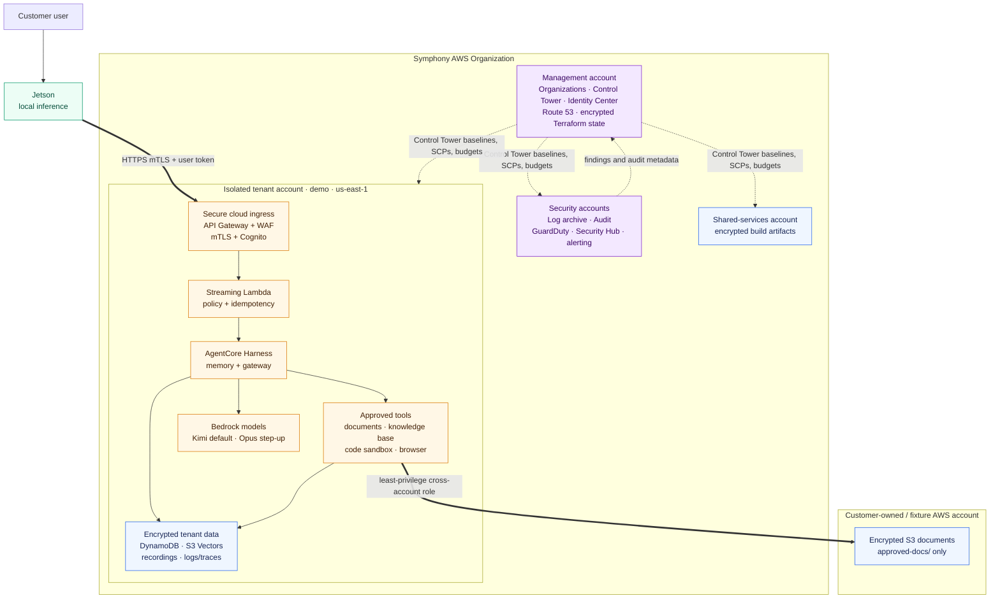

# Symphony AWS infrastructure

This slide-scale diagram is derived from every Terraform root under
`cloud/terraform/` and the architecture documents in `cloud/PLAN.md` and
`docs/superpowers/specs/`. It represents the configured `demo` pilot. Solid
arrows are request or data flows; dotted arrows are governance relationships.

For the inventory of what was actually deployed, how the pieces worked
together on a request, and the teardown record, see
[`aws-environment.md`](aws-environment.md).

## Notes

- Terraform is separated into bootstrap, landing-zone, organization,
  shared-services, tenant baseline/workload, sandbox fixture, and external
  connector roots. Remote state passes only declared outputs between roots.
- Control Tower owns its generated baseline resources; this Terraform declares
  the landing-zone configuration, organization additions, and explicit
  member-account resources without importing or duplicating Control Tower
  resources.
- All tenant application data stays in the tenant account. The fixture account
  remains the source of the sample documents; only the approved prefix may be
  read or indexed. Management, audit, log archive, and shared services do not
  host tenant prompts or connector credentials.
- The diagram excludes the planned Snowflake frontier route because no
  Snowflake Terraform resources are present. Local-only prompts remain on the
  Jetson and never traverse the cloud ingress.
